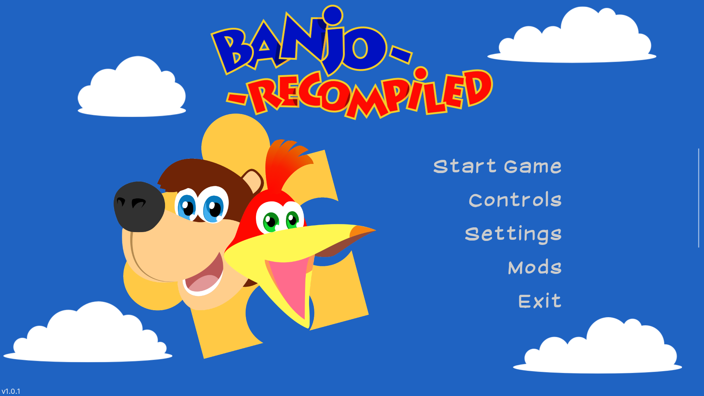

# 📱 Banjo: Recompiled — Community Android & Handheld Port

  
  
  
  
  

> [!NOTE]
> **Native Android-Only Fork**: This repository is a community-driven fork maintained by [dmillerzx](https://github.com/dmillerzx) dedicated **exclusively to native Android (`arm64-v8a`) handheld releases** — actively maintained and verified on the **Retroid Pocket 5** (Qualcomm Snapdragon 865, Adreno 650, Android 13) and generic AArch64 handhelds.
>
> * **Android Releases Only**: We do **not** publish Windows, Linux, or macOS releases from this repository. Desktop releases and core recompilation live upstream at [N64Recomp/N64Recomp](https://github.com/N64Recomp/N64Recomp) / [BanjoRecomp/BanjoRecomp](https://github.com/BanjoRecomp/BanjoRecomp).
> * **Handheld-Specific Optimizations**: All downstream optimizations (Adreno 650 RT64 crash guard, Turnip GPU driver loader, ZL+L1 crouch multi-bind, zero-touch `/storage/*/ROMs/n64/` ZIP hydration, and Rev A header diagnostics) are built specifically for the Android handheld environment.
> * Upstream Android port by [@AurelioB](https://github.com/AurelioB/BanjoRecomp-Android).
> * **No Game Assets**: This repository and its releases do not contain game assets or ROMs. You must provide an authentic **Banjo-Kazooie (USA) v1.0** ROM (`.z64`).

| Title Screen (1080p 16:9 on RP5) | In-Game 16:9 Widescreen |
| :---: | :---: |
|  |  |

### What Makes This Android Fork Different

| Feature | Android Handheld Implementation |
| :--- | :--- |
| **Adreno 650 / RT64 Crash Guard** | Fixes Qualcomm Adreno 650 startup crashes and prevents null-`VkPipeline` driver `SIGSEGV` faults |
| **Turnip GPU Driver Loader** | Built-in AdrenoTools driver loader with `meta.json` extraction (supports Mesa Turnip v24.3.0 R9v2) |
| **Zero-Touch ROM Hydration** | Auto-scans `/storage/*/ROMs/n64/` for `Banjo-Kazooie (USA).z64` / `banjo.z64` (when storage is readable) or imports `.z64/.n64/.v64/.zip` via in-app Android file picker |
| **ROM & Log Diagnostics** | Detects unsupported ROM revisions/corrupt files with on-screen dialogs and writes persistent boot logs to `Android/data/com.aure.banjorecomp/files/banjo.log` |
| **Handheld Controls & Display** | `ZL` + `L1` crouch multi-bind, `WindowInsetsController` immersive mode, and `sensorLandscape` orientation |

## Features

### Feature complete with the PC version

- High-framerate and widescreen support from the PC version.
- Faithful audio and original game behavior.
- Modern quality of life features such as note saving.
- Full mod support, including local mod and texture-pack import.

### Full controller & handheld hardware support

- **Primary Test Device**: Actively maintained and verified on the **Retroid Pocket 5 (RP5)** (Qualcomm Snapdragon 865 / Adreno 650, Android 13) at native 1080p, locked 60 FPS in 16:9 widescreen presentation.
- **Physical Controls**: Tuned controller mapping including modern dual-trigger crouch multi-bind (`ZL` + `L1`).
- **Adreno 650 / Snapdragon 865 Crash Guard**: Null-pipeline SPIR-V guard preventing driver `SIGSEGV` faults on Qualcomm devices.
- **Turnip GPU Driver Loader**: Built-in AdrenoTools driver loader supporting Mesa Turnip drivers (e.g. Turnip v24.3.0 R9v2) for enhanced Vulkan stability.
- **ROM Setup (Auto-Scan or In-App Picker)**: You can **either** place your **Banjo-Kazooie (USA) v1.0** `.z64` (`Banjo-Kazooie (USA).z64` or `banjo.z64`) in `<MicroSD>/ROMs/n64/` or `Android/data/com.aure.banjorecomp/files/` for automatic zero-touch hydration on launch, **or** select any `.z64`, `.n64`, `.v64`, or `.zip` manually via the **in-app Android file picker** on first launch.
- **Diagnostics & Logs**: Boot, ROM validation, and GPU driver logs are written to `Android/data/com.aure.banjorecomp/files/banjo.log`. Unsupported revisions (e.g. Rev A / v1.1) and invalid files display a clear explanation dialog rather than failing silently.
- *(Note: Upstream project was originally developed and tested on the dual-screen AYN Thor).*

### Android save management

The Android settings include a **Save Management** page for importing and exporting the active Banjo-Kazooie save and selecting an Android DocumentsUI folder for synchronized storage. The game keeps an app-private runtime copy for native I/O; when a folder is selected, its `banjo-kazooie.bin` document is authoritative across launches and the app writes a safe snapshot back when it pauses.

Selecting an empty destination copies the existing save into it. A destination containing a recognized Banjo save or backup is never overwritten automatically; import that file explicitly if it should replace the active save. See [Android save storage](docs/plans/android-save-storage.md) for backup and failure behavior.

### Dual-screen companion display

On supported devices, the second screen becomes a live companion display, including:

- Double tap to toggle secondary display on/off.
- Animated icons for game status and collectibles.
- Dynamic backgrounds based on the current game area.
- Live gameplay stats such as health, lives, notes, eggs, feathers, Jiggies, Mumbo tokens, Jinjos, and level context.
- Smooth transitions between areas.

## Screenshots

| Label | Primary display | Secondary display |
|---|---|---|
| Main menu |  |  |
| Slot select |  |  |
| Gruntilda's lair |  |  |
| Mumbo's Mountain |  |  |

## Mods on Android

So far, I've only tried the [BK Reloaded texture pack](https://thunderstore.io/c/banjo-recompiled/p/GhostlyDark/BK_Reloaded/)
Please report if you find an incompatible mod

## Development notes

For Android setup, build commands, ADB verification, screenshot capture conventions, and artifact hygiene, see [docs/android-port.md](docs/android-port.md).

For the experimental dual-screen implementation details, see:

- [Android dual-screen companion display API](docs/android-dualscreen-framework-api.md)
- [Dual-screen ownership boundaries](docs/plans/android-dualscreen-framework-ownership.md)
- [Dual-screen transition findings](docs/android-dual-screen-transition-findings.md)

## Upstream project and credits

This Android port is based on Banjo: Recompiled. See [README.original.md](README.original.md) for the original project overview, desktop feature list, FAQ, and upstream acknowledgements.

Core upstream projects include:

- [N64: Recompiled](https://github.com/N64Recomp/N64Recomp)
- [RT64](https://github.com/rt64/rt64)
- [N64ModernRuntime](https://github.com/N64Recomp/N64ModernRuntime)
- [RecompFrontend](https://github.com/N64Recomp/RecompFrontend)
- [Banjo-Kazooie Decompilation](https://gitlab.com/banjo.decomp/banjo-kazooie)
